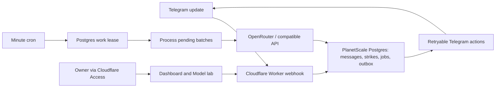

# Watchtower

A private Telegram moderation bot and model evaluation dashboard, hosted on Cloudflare Workers with **PlanetScale Postgres** for application data. A minute cron processes persisted jobs; Postgres leases coordinate concurrent workers. A separate Durable Object handles the optional signed-in Telegram owner connection and full-history cleanup. Local development uses an isolated SQLite adapter. It needs no always-running VM or laptop.

The bot starts in **observation mode**. It classifies and logs messages, but does not delete, award strikes, or ban until you choose **Enforce** in Settings.

For this workspace's configured hostname, current deployment state, and remaining Access setup, see [deployment status](docs/deployment.md).

## What is implemented

- Authenticated Telegram webhook; messages are persisted before acknowledgement.
- Per-supergroup, per-user strike state, surviving restarts and deployments.
- Automatic group discovery with owner activation, permission checks, an Add bot link, and a workspace selector. New groups start in Observe and can copy an existing policy; messages, strikes, datasets and runs remain separate.
- Strike one: delete the spam message and record a strike.
- Strike two: delete the spam and purge that user's **tracked messages sent within the last 48 hours**.
- Strike three: permanently ban with `revoke_messages: true`.
- Editable spam policy, model, thresholds, batch window, token budget, retention, and exempt IDs.
- OpenRouter chat-completions for Gemini and other models, a dedicated **Jev Decisions API** adapter, and custom OpenAI-compatible endpoints.
- Image moderation with automatic vision routing, a configurable fallback for text-only models, private image previews, and a connection check that creates no strikes.
- Owner-only dashboard, message review, manual strikes, reset/unban, retry controls, audit log, and export.
- Optional Telegram owner-account connection with encrypted sessions and per-user full-history deletion, including messages older than 48 hours. See [setup](docs/deployment.md#current-owner-account-message-history-cleanup).
- Telegram Desktop JSON imports, captured-message datasets, editable human labels, and durable model comparisons.
- Precision, recall, F1, false positives, usage, total model-call latency, provider-reported cost, threshold curves, and saved run exports.
- Labels save independently per message. Other messages and pagination remain usable while a save is pending; matching run metrics update locally without reloading every saved prediction. Save errors identify the affected message, and stale refresh responses cannot undo newer successful saves.
- Reasoned corrections automatically generate, test and revise policy updates using prior mistakes, with up to four candidates, fresh final checks, one owner approval, an Observe rollout, and version rollback. See [Policy improvement](docs/policy-improvement.md) for triggers, gates and limits.
- Model lab loads saved runs in pages bounded by message count and JSON size. Models with identical original samples share a cached snapshot; scores and human labels refresh from Postgres. Postgres assembles response JSON and overview data to reduce Worker CPU. Dashboard reads retry transient failures without replaying mutations. The Workers Free plan still has a 10 ms CPU allowance; cold requests and larger jobs can still exceed it. See [Worker limits](https://developers.cloudflare.com/workers/platform/limits/).

### Telegram differences from the screenshot

The Bot API does **not** expose Telegram's native **Report Spam** action or a group-history export method. Watchtower records spam internally; it does not send a platform spam report. Strike two can only purge messages the bot has tracked and that Telegram allows it to delete, generally under 48 hours old. Strike three bans the user and separately queues deletion of tracked messages within Telegram's deletion window. A successful ban is not proof that the user's messages disappeared. For older or untracked messages, connect your Telegram owner account in **Strike history** and confirm **Delete all messages** on that user's row. This calls Telegram's client API and preserves the user's strikes and ban. Historical imports are evaluation data and never trigger live moderation. [Telegram Bot API](https://core.telegram.org/bots/api#deletemessage), [banChatMember](https://core.telegram.org/bots/api#banchatmember), [deleteParticipantHistory](https://core.telegram.org/method/channels.deleteParticipantHistory).

Text, captions, poll questions, and hidden message links are classified. With image processing enabled, photos and JPEG/PNG/WebP image documents are inspected together with their captions, including photos without captions. Unsupported or unavailable images and failed vision checks enter **Media review** without a strike. Videos, animations, stickers, and voice notes are not inspected; available captions are still classified. This version does not transcribe audio or analyze video. Anonymous admins, channel senders, bots, the owner, and known administrators are exempt. A failed administrator lookup prevents enforcement.

## Run locally

Requires Node **22+**.

```sh
npm ci
npm run dev
```

Open **http://127.0.0.1:5173**. The script creates an ignored `.dev.vars` from `.dev.vars.example`. Wrangler runs on port 8787, Vite on 5173, and local SQLite state lives in `.wrangler/`.

The local owner bypass only works when `DEV_MODE=true` **and** the request URL is loopback. The development script sets this flag locally; production config keeps it false. Without credentials you can inspect the UI, import/label/export datasets, and try the illustrative starter dataset. Model comparisons require actual provider credentials; no benchmark results or live group activity are fabricated.

Use a separate test supergroup if you add a bot token locally. Worker secrets and local files are never returned to the browser.

The local SQLite adapter supports one test group. Multi-group provisioning uses Postgres; opt into the integration tests only with a disposable loopback database using `TEST_POSTGRES_URL`.

```sh
npm run check          # TypeScript, Workers-runtime tests, UI build
npm run format:check
npx wrangler deploy --dry-run
```

## Deploy to Cloudflare

### 1. Create the Telegram bot

Create a bot with [@BotFather](https://t.me/BotFather). Add it to your **supergroup** as an administrator with **Delete messages** and **Ban users / restrict members** permissions. Administrator bots receive group messages; if delivery is incomplete, verify privacy mode and permissions. [Telegram bot FAQ](https://core.telegram.org/bots/faq#what-messages-will-my-bot-get).

You need the numeric supergroup ID, for example `-1001234567890`, and your numeric Telegram user ID. Username strings are not used as durable identity. Existing messages are not backfilled through the Bot API.

Before registering a webhook, save the bot token in ignored `.dev.vars`, send a message in the group and `/start` directly to the bot, then run `npm run telegram:discover`. It prints available group and sender IDs without message contents or tokens, and preserves pending updates. Choose your own account as the owner; do not select another group member.

### 2. Configure Worker variables

Edit `vars` in `wrangler.jsonc`:

```json
{
  "DEV_MODE": "false",
  "TELEGRAM_CHAT_ID": "-1001234567890",
  "TELEGRAM_BOT_USERNAME": "your_bot_username",
  "WORKER_URL": "https://your-worker.your-subdomain.workers.dev",
  "OWNER_TELEGRAM_ID": "123456789",
  "ADMIN_EMAIL": "you@example.com",
  "ACCESS_TEAM_DOMAIN": "https://your-team.cloudflareaccess.com",
  "ACCESS_AUD": "your-access-application-audience"
}
```

`OWNER_TELEGRAM_ID` protects your Telegram account from moderation. `ADMIN_EMAIL` is the **single** dashboard owner. Both should refer to you. `ACCESS_TEAM_DOMAIN` includes `https://`; the audience tag comes from your Access application's configuration.

`TELEGRAM_CHAT_ID` is the initial workspace and stable database namespace. Keep it unchanged when adding groups. `TELEGRAM_BOT_USERNAME` supplies the dashboard's Add bot link. `WORKER_URL` is the public Worker origin used for the webhook and authenticated per-group work invocations; keep it on `workers.dev` so Cloudflare Access does not intercept Telegram or scheduling.

Log in and create the initial deployment:

```sh
npx wrangler login
npm run deploy
```

The initial deployment fails closed for dashboard access until Access is configured. Provision Postgres as described below. The production entry point binds `TELEGRAM_ADMIN` for owner-account cleanup; all moderation and lab data remain in Postgres. `wrangler.local.jsonc` provides the separate local SQLite development adapter.

### 3. Add secrets

Use Wrangler's interactive prompts. Do not put tokens in committed config or command-line arguments.

```sh
npx wrangler secret put TELEGRAM_BOT_TOKEN
npx wrangler secret put TELEGRAM_WEBHOOK_SECRET
npx wrangler secret put OPENROUTER_API_KEY
```

Choose a random webhook secret with 16–256 characters from `A-Z`, `a-z`, `0-9`, `_`, and `-`. For example, generate one locally with `openssl rand -hex 32` and save it securely. The same value must be supplied to the registration script.

One OpenRouter key enables Gemini, other OpenRouter chat models, and Jev. No separate Gemini account or API key is needed.

Production application reads, writes, strike state, job cursors, and scheduler leases all live in PlanetScale. There is no Cloudflare database read quota in the production path. Cloudflare Worker compute/request limits and provider limits still apply. [Workers limits](https://developers.cloudflare.com/workers/platform/limits/).

The dashboard loads completed lab samples on entry, explicit refresh, and return to a visible tab. Active runs poll compact status records every five seconds and load predictions when a run finishes. Hidden tabs stop polling. Positions and timestamp indexes bound sample batches and recent-message reads. Telegram updates receive a success response only after Postgres commits; database outages receive retryable failures.

### PlanetScale Postgres

Use a PlanetScale **Postgres** database, with a primary pooled connection on **port 6432**. The smallest single-node plan starts at $5/month; pricing is based on provisioned resources, with storage/network extras possible. [PlanetScale pricing](https://planetscale.com/pricing), [connections](https://planetscale.com/docs/postgres/connecting).

Save `PLANETSCALE_DATABASE_URL` in ignored `.dev.vars`. TLS is required and certificate verification remains enabled. Production uses `pg` through the `HYPERDRIVE` binding, with query caching disabled and origin TLS set to `verify-full` using the ISRG Root X1 CA. Hyperdrive pools connections to the existing PlanetScale database on port 5432; it does not create a new database or change the Workers plan. Its free allowance is 100,000 SQL statements per day (including transaction statements). Without the binding, local tools use `PLANETSCALE_DATABASE_URL` directly with verified TLS. Client connections remain scoped to requests and closed afterward. Transactions use `SET LOCAL` and a group-specific advisory lock; values are always bound parameters.

The app uses schema `watchtower_g<supergroup ID without its minus sign>`. A standard PlanetScale read/write role cannot create this initial schema. Use the default role once to create the schema and grant your application role `USAGE, CREATE` on that schema, or save a temporary default-role connection as `PLANETSCALE_ADMIN_DATABASE_URL` locally. The setup script uses port 5432 for DDL; this admin connection is never deployed. [PlanetScale role permissions](https://planetscale.com/docs/postgres/connecting/roles).

The group registry and all additional groups stay in that initial schema. The original workspace keeps its existing tables; another group receives tables prefixed `g<its numeric ID without the minus sign>_`. Each group has its own settings, messages, users, actions, work lease, usage and lab tables. Activating another group needs the application's existing `CREATE` privilege on this schema, without another database, role, or admin credential.

```sql
-- Example for supergroup -1001234567890. SQL role names omit the connection's .branch suffix.
CREATE SCHEMA IF NOT EXISTS "watchtower_g1001234567890";
GRANT USAGE, CREATE ON SCHEMA "watchtower_g1001234567890" TO "your_application_role";
```

```sh
npm run database:setup                    # Additive schema initialization; preserves existing data
npx wrangler secret put PLANETSCALE_DATABASE_URL
```

Deploy `wrangler.jsonc`. This workspace explicitly abandoned the legacy Cloudflare history transfer at the owner's request; migration `v3` deletes both old Durable Object namespaces. Current PlanetScale datasets, labels, predictions, settings, and usage are retained. Existing settings remain in Observe until the owner enables Enforce.

For an existing installation whose old history has not been copied and is intentionally being abandoned, `npm run database:setup -- --discard-legacy-history` marks the old transfer cancelled and unlocks live state. This command refuses to abandon a partially copied ledger, preserves all current Postgres application tables, and removes retry state. It must not be used as a routine fix for database outages. New installations start ready automatically; schema initialization never overwrites existing storage state.

`GET /api/storage` reports setup state; the former migration-retry endpoint is removed. Imports and saved samples use bound bulk inserts. The minute cron owns a renewable, expiring Postgres lease; transaction writes are fenced to that owner so an expired invocation cannot overwrite its replacement. Provider calls and Telegram effects happen outside transactions. A crash releases work after the lease expires, and the next cron resumes persisted cursors/retries. Labelling and webhooks remain available during model calls.

For disposable local Postgres integration tests:

```sh
TEST_POSTGRES_URL=postgresql://user@127.0.0.1:5432/watchtower_test npm run check
```

These opt-in tests clear only the test group schema in a loopback database. They exercise the real Workers runtime and Postgres, including concurrent transactions, strikes, imports, labels, retryable errors, safe history abandonment, overlapping cron invocations, expired-worker fencing, and preservation of current lab data. Without the variable, the Postgres integration tests are skipped. `npm run dev` explicitly uses local SQLite, keeping local owner access separate from production Postgres.

### 4. Configure the owner-only dashboard

Recommended layout:

- **Dashboard:** a custom hostname such as `moderation.example.com`, behind a Cloudflare Zero Trust **Access self-hosted application**.
- **Telegram webhook:** `https://watchtower-telegram.<your-subdomain>.workers.dev/telegram/webhook`. Keep this reachable without an Access login; the Worker validates the webhook secret.

Add the dashboard hostname as a Worker custom domain, through Cloudflare or `routes` in `wrangler.jsonc`:

```json
"routes": [{ "pattern": "moderation.example.com", "custom_domain": true }]
```

Create an Access application for the dashboard hostname. Use an **Allow** policy for **only your email**, with your preferred identity provider or one-time PIN. Copy its audience tag into `ACCESS_AUD`.

If the webhook shares the dashboard hostname, create a more-specific Access application/path policy to bypass Access **only for `/telegram/webhook`**. Do not bypass the dashboard or `/api/*`. Telegram cannot complete an Access login.

The Worker independently verifies Access JWT signature, issuer, audience, expiry, and exact owner email. It protects static assets too, including direct `workers.dev` dashboard requests. A claimed email header alone is never trusted. Mutations require a same-origin request and a custom request header. [Cloudflare Access JWT validation](https://developers.cloudflare.com/cloudflare-one/access-controls/applications/http-apps/authorization-cookie/validating-json/).

### 5. Register the webhook

Set these variables in ignored `.dev.vars`, a secure local shell session, or a secret manager. Existing environment variables take priority over `.dev.vars`:

- `TELEGRAM_BOT_TOKEN`
- `TELEGRAM_WEBHOOK_SECRET`
- `TELEGRAM_CHAT_ID`
- `OWNER_TELEGRAM_ID`
- `WORKER_URL`, such as `https://watchtower-telegram.<your-subdomain>.workers.dev`

Then run:

```sh
npm run telegram:setup
```

The script verifies that the bot can delete/restrict and that your account is an admin, then registers `message`, `edited_message`, and `my_chat_member` updates. It preserves pending updates. It does not print tokens. A webhook update receives HTTP 200 only after durable ingestion or setup metadata commits; failures return a retryable status.

If Telegram cannot resolve a newly created hostname while public DNS already resolves it, you can temporarily supply `TELEGRAM_WEBHOOK_IP` with one of that hostname's current IPv4 addresses. This uses Telegram's supported `ip_address` override. Rerun without the override after DNS propagation to return to DNS-managed delivery. [setWebhook parameters](https://core.telegram.org/bots/api#setwebhook).

In Settings, choose **Check Telegram** to inspect permissions and webhook errors. Start in Observe, label real examples in Model lab, and select Enforce once the results are suitable. Existing observation decisions are **not retroactively enforced**; recheck or manually moderate a specific message if needed.

## Connect another group

1. Open the group selector in the sidebar → **Add or manage groups**.
2. Choose **Add bot to a group**, select your Telegram group, and grant **Delete messages** and **Ban users**. Your configured owner Telegram account must also be a group administrator. The link requests these bot permissions. [Telegram bot links](https://core.telegram.org/api/links#group-channel-bot-links).
3. Watchtower detects membership and permission updates automatically. The setup screen refreshes every five seconds while visible; **Refresh groups** is also available. If the bot was added before discovery was enabled, send `/watchtower` from your owner account in that group. [ChatMemberUpdated](https://core.telegram.org/bots/api#chatmemberupdated).
4. Choose defaults or copy an existing group's policy, model, thresholds and limits. Select **Activate in Observe**. The server verifies current bot permissions and your administrator membership, then provisions its separate workspace.
5. Switch groups from the sidebar. Review that group's feed and enable **Enforce** in its Settings when ready.

Pending groups retain only setup metadata. They do not capture message contents, call models or enforce moderation. Activation and all dashboard actions require the existing single-owner Cloudflare Access login. Copies exclude exemptions, messages, strikes and lab data. Each activated group uses the same bot credentials and provider connections, without another deployment or webhook.

Full three-strike moderation requires a Telegram supergroup. A basic group appears in setup but cannot activate until Telegram upgrades it and supplies its new supergroup ID. If the bot is removed or loses either moderation permission, Watchtower pauses that group's live settings and processing. Its history stays available. After restoring the bot and permissions, explicitly reconnect it in Observe; no automatic return to Enforce occurs.

## Models and evolving the policy

The default policy catches scams, unsolicited promotion, phishing, and disruptive repetition. Ordinary greetings/questions and relevant links are allowed. Edit the full policy in Settings. The experiment prompt in Model lab can differ from the live policy, and is saved with each run.

Repetition context includes up to three prior messages from the same sender within ten minutes. Telegram Desktop imports use the same time window; if timestamps are missing, no recent burst is inferred. Normalized datasets may supply explicit context for controlled experiments.

### Image moderation

Settings → **Image moderation** enables image inspection by default. Watchtower first checks whether the selected model accepts images. If it does, that model sees the image and caption together. Otherwise, it uses the configured **Vision fallback provider/model**. Jev's text-only Decisions adapter always uses this fallback for images; ordinary text continues through Jev. Clearing the fallback model sends unsupported image requests to review. Both routes use the existing live policy, score thresholds, sender protections, and three-strike ledger. The feed records the actual model used.

OpenRouter capabilities come from its small, model-specific metadata endpoint and are cached for an hour. A custom compatible provider must declare its image-capable model IDs using `imageModels` in `MODEL_PROVIDERS_JSON`; an unknown capability never results in silently discarding the image. [OpenRouter image inputs](https://openrouter.ai/blog/tutorials/send-image-to-llm/).

Only a Telegram file ID is persisted. The Worker retrieves image bytes through `getFile`, verifies a JPEG/PNG/WebP signature, and supplies an inline base64 image to the provider. Telegram's credential-bearing download URL is never sent to the model or browser. Image previews pass through the same owner authentication and group selection as other dashboard data. Photos use the largest Telegram rendition within 1,280 pixels and 512 KB when available. Downloads are limited to 512 KB, even without a content length. Larger or unsupported images enter review. Each vision request contains one image; ordinary text retains batching. [Telegram file retrieval](https://core.telegram.org/bots/api#getfile).

Image usage counts toward the existing live moderation budget. Reservations include 4,096 tokens per image instead of counting its base64 transport as text, and settle against reported usage. A budget hold stays queued until reset or a budget increase; it does not issue a strike. Provider failures and invalid output go to review with an explicit **Recheck** control, and paid usage is recorded even for invalid output. Image replacements invalidate older in-flight decisions.

**Check vision connection** uses a small built-in geometric image with the current model choices. It makes a real provider call and records live usage, but changes no settings and creates no message, strike, deletion, or ban. It verifies connectivity and output mapping, not model accuracy. Model lab imports and captured datasets still compare **text and captions only**; importing Telegram's JSON does not upload the export's local photo files.

For an existing installation, run `npm run database:setup` before deploying this version. The additive upgrade adds `image_file_id` to every provisioned group's messages table and preserves settings, strikes, datasets, labels, and runs. Older saved settings inherit the new defaults without rewriting their policy or enforcement mode. Older messages lack file IDs and are not automatically reclassified.

Built-in adapters:

| Provider          | Credential           | Example model                  | API                        |
| ----------------- | -------------------- | ------------------------------ | -------------------------- |
| OpenRouter        | `OPENROUTER_API_KEY` | `google/gemini-2.5-flash-lite` | `/api/v1/chat/completions` |
| Jev on OpenRouter | `OPENROUTER_API_KEY` | `typesafe/jev-1.13`            | `/api/alpha/decisions`     |

Model IDs are editable; examples are starting points, not a claim that these are the best current choices. Verify availability in your provider account.

Jev is a decision model with a separate API, not a chat-completions model. Watchtower sends a `state` object with the policy and messages, and a `noul` question per message. The returned probability becomes the spam score. Jev does not generate explanations; the dashboard says so. [Jev guide](https://openrouter.ai/docs/guides/community/jev), [Decisions API schema](https://openrouter.ai/docs/api/api-reference/alphadecisions/submit-a-decisions-request).

Chat adapters request structured JSON, then validate every ID, score, and output count before using decisions. Prompts never include ground truth labels or sender names/IDs; recent same-sender context is included. Responses cannot call Telegram tools. [OpenRouter structured outputs](https://openrouter.ai/docs/guides/features/structured-outputs).

To add or override a custom endpoint, store a JSON array as the `MODEL_PROVIDERS_JSON` Worker secret:

```json
[
  {
    "id": "custom",
    "name": "My compatible provider",
    "baseUrl": "https://provider.example/v1",
    "apiKeyEnv": "CUSTOM_API_KEY",
    "format": "json_object",
    "imageModels": ["your-vision-model-id"]
  }
]
```

```sh
npx wrangler secret put MODEL_PROVIDERS_JSON
npx wrangler secret put CUSTOM_API_KEY
```

Supported formats: `json_schema`, `json_object`, `plain`, `decisions`. Use `plain` if a chat endpoint doesn't support a response-format parameter; it must still return the requested JSON. Do not silently fall back across providers. Endpoint credentials are configured server-side; URLs must use HTTPS and cannot embed credentials. Custom configurations can override built-in IDs if needed.

## Compare models on your group

1. In [Telegram Desktop](https://desktop.telegram.org), open the group's menu → **Export chat history** → **Machine-readable JSON**. Wait until Telegram finishes exporting, then import the resulting JSON file in Model lab. Importing while Telegram is still writing the file produces incomplete JSON. Prefer a single-chat export. A multi-chat export can be imported through the API with an explicit `chatId`. [Telegram export guide](https://telegram.org/blog/export-and-more).
2. Large JSON files are read incrementally in the browser and uploaded automatically in batches of up to 250 text messages and 900 KB. One file becomes one dataset; file imports have no 12 MB or 10,000-message cap. Labels and dataset exports use paginated requests, and comparisons sample the full dataset without loading it all into the Worker. The effective ceiling is available browser and Cloudflare storage capacity. Alternatively, create a dataset from the latest 10,000 retained live text messages. The export button downloads retained captured messages in pages, including decisions and human labels.
3. Label a representative mix of real spam and legitimate messages. Include short greetings, relevant links, mixed languages, repeated posts, and boundary cases. Imported labels are never inferred from the bot's scores. Do not use the small illustrative starter corpus to choose a production threshold.
4. Select up to five models and a sample size (default 200, maximum 1,000). The same evenly sampled dataset snapshot and policy are used for each model. Jobs are persisted and run in bounded batches from the minute cron, prioritizing live moderation between chunks. Gemini uses chat completions; Jev and Cloudflare Clef automatically use OpenRouter's Decisions API, including when the general OpenRouter connection is selected. Decisions batches contain at most five messages to reduce repeated context overhead. [OpenRouter Jev](https://openrouter.ai/docs/guides/community/jev), [Clef Omni](https://openrouter.ai/cloudflare/clef-omni).
5. Click **Review messages** to inspect the scored sample side by side across models with identical messages, context, and policy. See each message, spam score, threshold decision, and available explanation. Filter flagged posts, model disagreements, unlabelled messages, false positives, or missed spam. Expand a message for its full text and recent sender context. Optionally hide model scores while labelling to reduce anchoring. Label a representative mix, including messages every model allowed; flagged-only review is not a representative accuracy estimate.
6. Mark messages **Legitimate** or **Spam**. These human review labels update quality metrics from already saved scores across matching runs; no additional model calls are made. Original run labels, prompts, and predictions remain unchanged. Reviews also update matching source dataset labels for subsequent experiments. Move the threshold slider to inspect precision, recall, F1, false positives, and the trade-off curve for free. Metrics exclude unlabelled or unscored examples and show a dash when undefined.
7. Export runs for reproducibility. Exports include the immutable original snapshot, current review labels, effective labels, threshold, and metrics. Run a new experiment to test a different model or prompt. Choose a threshold with acceptably few false positives on a separate held-out sample, select the model and policy in **Settings**, and observe live results before enabling automatic bans.

Imports appear in the dataset list only after every batch is stored and the entire file parses successfully. Upload progress and cancellation are available in Model lab. Transient upload failures retry the same batch without duplicating messages. Failed or cancelled imports are removed; abandoned uploads are removed by daily cleanup after 24 hours of inactivity. The legacy single-request import API retains its request and 10,000-message guards; the dashboard uses the streaming import API.

Model lab has no daily token budget. It tracks its usage separately and cannot consume the live moderation allowance. Provider billing still applies. Failed runs have a Resume action that continues from their saved cursor. Malformed output retries with smaller batches, stopping if a single-message response is still invalid. Chat requests use opaque temporary IDs, exact result-count constraints, and strict validation before mapping results back to Telegram IDs. Usage and latency from unusable responses are still recorded, including provider request IDs when supplied. Historical failures from before this accounting fix may have unknown usage.

Scores are model signals, not a guarantee of calibrated probability. Jev provides native decision probabilities; chat models provide requested numeric scores. Compare each on empirical precision/recall, and repeat after policy changes. Cost is provider-reported USD when available; an absent price is shown as a dash. Total latency sums model-call durations across chunks, not end-to-end queue waiting time. This implementation makes no winner claim without real group data and model calls.

## Reliability, batching, and storage



Each supergroup has its own tables and work lease within the initial Postgres schema. The `users` table is keyed by Telegram user ID, so strike identity is **(chat ID, user ID)**. Message IDs are group-scoped. Short transactions and a group-specific advisory lock make message deduplication, strike increments, outbox allocation, and evaluation cursor commits atomic across stateless Worker requests. Dashboard requests and their retries carry the selected group explicitly; a workspace switch cannot redirect an upload, export or label save already in progress.

With multiple active groups, the minute cron dispatches a separate authenticated Worker invocation per group. Each invocation checks the active registry record and acquires that group's persisted lease. A failure for one group does not overwrite another group's cursors or strikes, and persisted work resumes on a later tick. The original single-group path remains direct to keep its free-runtime overhead small.

The production config enables `global_fetch_strictly_public` so scheduled HTTP calls route through the public Worker endpoint, including loopback calls to this Worker. The internal work route uses a separate secret header and never trusts dashboard or Telegram user IDs as scheduler authorization. [Cloudflare fetch routing](https://developers.cloudflare.com/workers/configuration/compatibility-flags/#global-fetch-strictly-public).

There is one authenticated webhook invocation per Telegram update. Model calls are batched with a configurable minimum collection window and up to 20 messages by default. Production processes due work on the next minute cron tick, so the collection window is not a promise of sub-minute deletion. Busy groups drain in bounded batches, prioritizing live messages and actions between lab chunks. Long text/context can reduce batch size. A tick stops starting more batches after its time window; an in-flight batch is allowed to finish. Sparse groups cannot save much by batching. Messages remain visible until classification and Telegram deletion complete.

No browser or laptop must remain open. A separate daily cron performs retention cleanup. Cloudflare documents that cron changes can take up to 15 minutes to propagate. [Cron Triggers](https://developers.cloudflare.com/workers/configuration/cron-triggers/).

- Duplicate webhook deliveries do not duplicate messages or strikes.
- Edits can be reclassified, but one message can award at most one strike. Revision checks discard old in-flight results. Response order never changes the chronological strike order within a batch.
- Administrator lists are checked before classification, and membership is checked again before strikes and Telegram actions. Lookup failures remain non-destructive.
- Strike recording and outbox creation happen in one Postgres transaction. Telegram effects are retried independently, so a retry cannot award another strike.
- Provider errors/malformed output cause no enforcement. Classification retries back off and stop after five attempts; the feed provides Recheck. Action retries honor `retry_after`, back off, and stop after eight attempts; the strike history provides Retry failed actions.
- External Telegram effects are **at least once**, since no database can atomically commit a Telegram request. Deletes and bans are idempotent in practice. A ban is recorded as confirmed only after Telegram reports success. Delete counts include tracked messages that Telegram reports successfully removed/skipped, plus history revoked by a confirmed ban; they are not a server-side inventory of all historical posts.
- Production cron performs one bounded batch per group per minute: up to two existing actions (bans first), or up to two messages for classification. Newly awarded actions run on a subsequent tick. Existing actions never wait behind model calls. Duplicate outstanding bans are coalesced; a user reset still permits future strikes and bans.
- Pause holds model classification and moderation effects. New messages continue to be captured and are queued on resume. Evaluation jobs are independent and can be cancelled per run.
- User reset cancels queued/failed actions, resets strikes, and unbans an account the bot recorded as banned. It preserves old message strike markers so replay cannot resurrect a forgiven strike. Deleted messages cannot be restored.
- Live moderation usage is reserved conservatively before calls. Reported usage replaces the reservation even when the response fails validation; missing usage keeps its reservation. Budget exhaustion holds live messages without consuming failure retries until the midnight UTC reset or a budget increase. Model lab runs without a daily allowance and records actual or estimated usage in a separate counter. This controls moderation workload, but is **not a hard provider billing cap**, especially for tokenizers, reasoning, and failed/billable requests. Set a provider account/key spend limit too. When upgrading a previously shared counter with mixed activity, its historical usage remains conservatively counted against moderation until reset; lab-only usage today is reclassified when no live activity exists.
- Default retention is 30 days for messages/audit. Pending/error messages and messages associated with unfinished actions are retained for recovery. Strikes persist until reset. Datasets and evaluation snapshots persist until explicitly removed; dataset deletion intentionally keeps run snapshots. A deploy does not reset Postgres.

For one public community this is a compact design. If you later need many very busy groups or large offline corpora, consider separate queued evaluation workers and archive storage; keep user strike transitions strongly consistent. See [research notes](docs/research.md) for the trade-offs.

## Project map

| Path                         | Purpose                                                                   |
| ---------------------------- | ------------------------------------------------------------------------- |
| `worker/index.ts`            | Public routes, webhook authentication, owner auth, asset protection, cron |
| `worker/group.ts`            | Database-independent moderation, strike transitions, actions, evaluations |
| `worker/classifier.ts`       | Chat-compatible and Jev adapters, validation, usage reservations          |
| `worker/auth.ts`             | Access JWT verification, local bypass, mutation protection                |
| `worker/import.ts`           | Telegram/Desktop and normalized dataset imports                           |
| `shared/types.ts`            | Config validation and shared API types                                    |
| `shared/metrics.ts`          | Threshold-dependent evaluation metrics                                    |
| `src/App.tsx`                | React admin UI                                                            |
| `scripts/telegram-setup.mjs` | Permission checks and authenticated webhook registration                  |
| `tests/`                     | Unit and real Workers-runtime/SQLite integration tests                    |

Tests use mock external API responses, an isolated local SQLite adapter, and optional real loopback Postgres. They do not contact a live Telegram group or a paid model. Deployment and live provider verification require your credentials and Cloudflare account.
